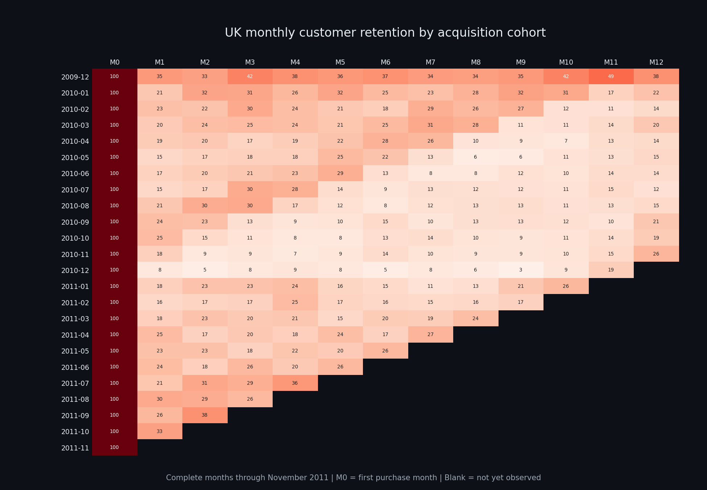

# Retention and Cohort Analysis Dashboard

An interactive analysis of repeat purchasing in the [UCI Online Retail II dataset](https://archive.ics.uci.edu/dataset/502/online+retail+ii). The business question is: **How does repeat purchase behavior vary by acquisition month, and where should a retailer test a retention intervention?**

The dashboard uses **805,549 cleaned transaction line items** from approximately 1.07 million raw rows. It combines Python data cleaning, SQLite storage, DuckDB cohort SQL, Plotly charts, and Streamlit filters. The default view is United Kingdom. The source covers December 2009 to 9 December 2011; analysis excludes the incomplete December 2011 month.

[Open the live Hugging Face dashboard](https://huggingface.co/spaces/Adityax-07/Retention-and-Cohort-Analysis).



## What to look at

- **Heatmap:** customer retention by acquisition cohort and months since first purchase. An observed month with no purchases is 0%; a future month is blank.
- **Retention curves:** selected cohorts and the average of cohorts observed at each age.
- **Business insights:** M3 retention, fixed-window M0–M6 revenue per acquired customer, and a clearly labeled win-back experiment scenario.
- **Country filter:** a country's cohort starts with the customer's first purchase *in that country*. Revenue and order counts use transactions in the same country.

## Example findings (United Kingdom)

Using complete months through November 2011, **21 cohorts** have an observed M3. Their mean M3 retention is **22.0%**; the December 2009 cohort is highest at **42.3%**. Across the **23 cohorts** with an observed M1, **1,212 of 5,153** acquired customers purchased again in M1 (**23.5%**). These are descriptive findings. The dataset does not identify acquisition channels or prove why a cohort performed differently.

## Metric definitions

| Metric | Definition |
|---|---|
| Acquisition cohort | Calendar month of a customer's first purchase in the selected geography |
| M0 | Acquisition month |
| M3 retention | Distinct cohort customers purchasing in month 3 ÷ original cohort size |
| M0–M6 revenue per customer | Revenue in months 0 through 6 ÷ original cohort size; shown only after M6 is complete |
| Observed month with no purchases | 0% retention and £0 revenue |
| Unobserved future month | Blank; excluded from comparisons |

The final source month is treated as incomplete unless the last transaction falls on its last calendar day. This is an operational cutoff based on the file's date range, not proof that all prior months are exhaustive.

## Run locally

```bash
pip install -r requirements.txt
streamlit run app.py
```

On a fresh Streamlit launch, [`snapshot.py`](snapshot.py) extracts the checked-in [compressed database](assets/retail.db.gz) to `data/retail.db` and checks its integrity. This avoids downloading and parsing the Excel workbook during startup. The snapshot contains the cleaned data described below, while the extracted database and source workbook are ignored by Git.

To reproduce the snapshot from the original UCI workbook, run `python ingest_data.py` and then gzip the resulting `data/retail.db`. This full rebuild downloads the source ZIP and can take several minutes.

## Pipeline

1. [`ingest_data.py`](ingest_data.py) reads both Excel sheets, removes rows without customer IDs, returns/cancellations (`Quantity <= 0`), and rows with nonpositive prices. It derives revenue as quantity × price and loads SQLite.
2. [`cohort_queries.py`](cohort_queries.py) assigns each customer to a first-purchase month, builds a calendar-month spine through the last complete month, aggregates activity, and calculates retention and revenue metrics with DuckDB CTEs and window functions.
3. [`app.py`](app.py) filters source transactions by geography, runs the analysis, and displays the charts and business interpretation.

The original raw workbook includes returns, cancellations, missing customer IDs, and nonpositive prices. Excluding these rows defines this as **positive-purchase retention** and means revenue is **gross positive-line revenue**, not net revenue or profit.

## Limits and next steps

- Small countries can have only one or two customers. The dashboard shows available data but avoids ranking cohorts when fewer than two have an observed M3.
- M0–M6 revenue per customer is a fixed-window measure, **not lifetime value**. It excludes future purchases and costs.
- Acquisition channel, marketing exposure, campaign costs, margin, and controlled experiment results are absent. The win-back scenario assumes a 5% recovery of M1 nonbuyers, one extra purchase at observed M1 revenue per active buyer, 12 comparable cohorts a year, and no cannibalization. It is a hypothesis to test.
- The chart above previews the default UK analysis. The live dashboard is linked near the top of this README.

## Tools

Python, pandas, openpyxl, SQLite, DuckDB SQL, Plotly, and Streamlit.
